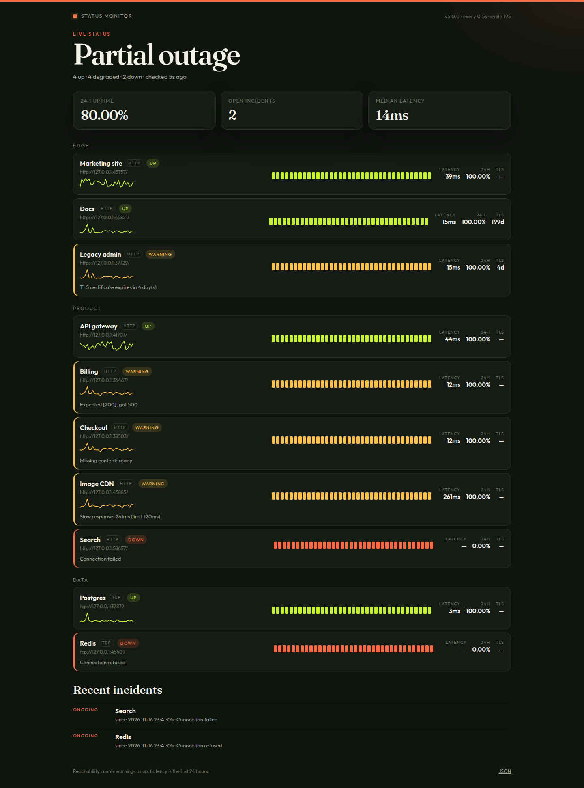

# Status Monitor

Async uptime monitor for HTTP(S), TCP, and ICMP. It keeps the v4 check loop — concurrent requests, one alert per outage, crash-safe state, rotating logs — and adds a config file, TLS expiry, content checks, SQLite history, a terminal dashboard, and a status page.

```bash
pip install -e ".[dev]"   # or: pip install -r requirements.txt
status-monitor --url https://example.com
status-monitor demo        # local services + status page at http://127.0.0.1:8080
```

`python -m status_monitor` is the same entry point.

## Features

**Checks**

- HTTP(S) status, latency, timeouts, retries, and redirects, all targets in one cycle
- Response body must contain a string, or match a regex
- TLS certificate expiry (days remaining, optional warning threshold)
- TCP connect and ICMP ping (the system `ping` binary)
- Per-target timeout, retries, expected statuses, and `verify_ssl`
- Bounded in-flight checks so a long list cannot open hundreds of sockets at once

**Alerts**

- Email (SMTP), Slack, Discord, and generic JSON webhooks
- One alert per outage, recovery when the target is UP again, cooldown after recovery so a flap cannot spam
- A WARNING (bad status, missing content, slow response, expiring certificate) does not end an outage and does not page
- Alert state in `.state.json` survives restarts. A corrupt file is quarantined instead of being overwritten

**History**

- Append-only `history.jsonl` (schema v5, still includes every v4 field)
- SQLite (`history.sqlite`) for uptime and latency percentiles
- `status-monitor report` prints the last 24 hours, or `--json` for scripts

**Surfaces**

- Classic line-by-line console output
- `--dashboard` live terminal UI (Rich)
- `--web` status page with uptime strips, sparklines, and `/api/status`

## Quick start

```bash
python -m venv .venv && source .venv/bin/activate
pip install -e .

# One URL, once a minute, until Ctrl+C
status-monitor --url https://example.com

# Several targets, still checked together
status-monitor --url https://example.com --url https://github.com --tcp 1.1.1.1:443

# One cycle, then the summary
status-monitor check --url https://example.com

# Config file (JSON, YAML, or TOML)
status-monitor validate --config config.example.yaml
status-monitor run --config config.example.yaml --web
```

`--config` and `--url` combine. Flags such as `--timeout` and `--expected-status` apply to the URLs you pass on the command line. Targets in the file keep their own settings.

## Demo

`status-monitor demo` starts local HTTP, TLS, and TCP services and monitors them. Nothing leaves the machine. Open the URL it prints (default [http://127.0.0.1:8080](http://127.0.0.1:8080)).

The page is the same one `--web` serves for a real config: overall status, 24-hour uptime, open incidents, per-target latency, and a strip of recent checks.



## Config

```yaml
global:
  interval: 60
  timeout: 10
  retries: 2
  expected_statuses: [200]
  verify_ssl: true
  alert_threshold: 1
  ssl_warn_days: 14          # warn when a cert expires sooner than this
  history_retention_days: 30 # SQLite only; JSONL is append-only
  concurrency: 20

alerts:
  email: you@example.com
  cooldown_checks: 3
  webhooks:
    - url: https://hooks.slack.com/services/XXX/YYY/ZZZ
      type: slack          # slack, discord, or generic
    - https://example.com/hooks/status

targets:
  - name: Marketing
    group: Edge
    url: https://example.com
    contains: "Example Domain"   # string or list; all must appear
    max_latency_ms: 800

  - name: Billing
    url: https://billing.internal/health
    expected_statuses: [200, 204]
    alert_threshold: 3
    verify_ssl: false

  - name: Postgres
    group: Data
    type: tcp
    host: db.internal
    port: 5432

  - name: Gateway
    type: ping
    host: 10.0.0.1
```

A target-level field overrides `global`. `contains` and `regex` need `method: GET` (the default). `method: HEAD` is allowed when you only care about the status code. Unknown keys are an error, so a typo fails `validate` instead of silently dropping a check.

`tcp://host:port` and `ping://host` work in the `url` field too. `enabled: false` skips a target without deleting it.

## CLI

| Flag | Default | Description |
| --- | --- | --- |
| `--config` | | JSON, YAML, or TOML file |
| `--url` | | HTTP(S) URL (repeatable; combines with `--config`) |
| `--tcp` | | `host:port` connect check (repeatable) |
| `--ping` | | ICMP ping via the `ping` binary (repeatable) |
| `--interval` | 60, or the config file | Seconds between cycles |
| `--timeout` | 10 | Timeout for CLI targets |
| `--retries` | 2 | Retries after the first attempt for CLI targets |
| `--expected-status` | 200 | Expected status for CLI URLs (repeatable) |
| `--alert-threshold` | 1 | Consecutive DOWN checks before an alert, for CLI targets |
| `--email` | | Inbox for DOWN and recovery mail |
| `--webhook` | | Webhook URL (repeatable). Slack and Discord hosts are detected |
| `--cooldown-checks` | 3 | DOWN checks to ignore after a recovery |
| `--contains` | | Text a CLI URL body must include (repeatable) |
| `--ssl-warn-days` | off | Warn when a CLI URL certificate expires sooner than this |
| `--no-verify-ssl` | off | Do not verify TLS for CLI URLs |
| `--log-dir` | `./logs` | Lock, state, log, JSONL, and SQLite directory |
| `--once` | off | One cycle, then the summary |
| `--web` | off | Serve the status page |
| `--web-host` / `--web-port` | `127.0.0.1:8080` | Where the page binds |
| `--dashboard` | off | Live terminal UI |
| `--quiet` | off | Hide per-check lines (the log file still gets them) |
| `--concurrency` | 50 | Max in-flight checks |
| `--retention-days` | 30 | Drop SQLite rows older than this (`0` keeps them) |

Subcommands: `run` (same as the bare command), `check` (one cycle), `report`, `validate`, `demo`.

```bash
status-monitor report --hours 24
status-monitor report --hours 0 --json
status-monitor validate --config config.example.yaml
```

There is no `--checks`, `--strict-uptime`, or `-v` from older notes. `--verbose` turns on debug logging.

## Status page and terminal UI

```bash
status-monitor run --config config.example.yaml --web --web-port 8080
status-monitor --url https://example.com --dashboard
```

- `/` is the rendered page. It refreshes every few seconds.
- `/api/status` is the same document as JSON (no secrets, no webhook URLs).
- `/healthz` returns 200 while the loop is keeping up, and 503 when the last cycle is stale. Docker uses it.

The page treats WARNING as reachable. Uptime is `(UP + WARNING) / checks`, the same definition as the shutdown summary. Latency percentiles are the last 24 hours.

`--dashboard` needs a terminal. The classic line log is the default, including under systemd and Docker.

## Alerts

Set SMTP in the environment or in `.env` in the working directory (existing variables win; `.env` is not required under systemd if you use `EnvironmentFile`):

```bash
cp .env.example .env
export SMTP_USER="yourbot@gmail.com"
export SMTP_PASS="your-16-char-app-password"
# optional: SMTP_HOST, SMTP_PORT (587), SMTP_TLS (true)

status-monitor --url https://example.com --email you@example.com
```

Gmail needs an [App Password](https://myaccount.google.com/apppasswords), not the account password.

`WEBHOOK_URL` is a single extra webhook. Prefer the config file when you have several. Slack and Discord incoming-webhook URLs are detected. Anything else receives:

```json
{
  "event": "down",
  "name": "Example",
  "url": "https://example.com",
  "status": "DOWN",
  "error": "Connection failed",
  "timestamp": "2026-06-04 04:55:00",
  "outage_start": "2026-06-04 04:55:00"
}
```

`event` is `down` or `recovery`.

### When an alert fires

Threshold 1, cooldown of 2 checks:

```
DOWN   alert fires
DOWN   already alerted, no duplicate
WARNING  outage continues (a 500 is not a recovery)
DOWN   still the same outage
UP     recovery mail, cooldown starts
DOWN   cooldown tick, suppressed
DOWN   cooldown finished, still suppressed
DOWN   cooldown is over, a new alert fires
```

The cooldown counts down through the suppressed DOWN checks. It does not reset when those checks arrive. If the target stays UP instead, the leftover cooldown is cleared, so an old flap cannot hide a later outage.

State is saved once per cycle. On restart, an outage that already paged does not page again.

## What a check means

| Result | Meaning |
| --- | --- |
| UP | Expected status (or a successful TCP/ping), content matches, latency and certificate are inside their limits |
| WARNING | The host answered, but the status, body, latency, or certificate is wrong. This counts as uptime and does not end an outage |
| DOWN | Connection failure, timeout, or too many redirects, after retries |

Retries use exponential backoff with jitter, capped at 30 seconds. The process sleeps `interval - time spent checking`, so a slow target does not push the schedule later every cycle.

HTTP failures keep the v4 messages: `Connection failed`, `Request timed out`, `Too many redirects`, and `Expected [200], got 503`.

## Files

Everything for a run lives in `--log-dir` (default `./logs`):

| File | Role |
| --- | --- |
| `status_monitor.lock` | `flock` so a second process refuses to start |
| `.state.json` | Alert counters. A corrupt file is moved to `.state.json.corrupt` |
| `monitor.log` | Rotating log, 5MB × 3 |
| `history.jsonl` | One JSON object per check |
| `history.sqlite` | Queryable history and incidents |

```json
{"v": 5, "url": "https://example.com", "name": "Example", "type": "http", "timestamp": "2026-06-04 04:52:00", "status": "UP", "status_code": 200, "response_time_ms": 142.3, "error": null, "attempt": 1, "ssl_days_remaining": 89}
```

`v` 5 adds `name`, `type`, and `ssl_days_remaining`. The v4 fields are unchanged.

On Ctrl+C (and on SIGTERM, so Docker and systemd stop cleanly) the process prints the session summary: counts, uptime, min/avg/max, and p50/p95/p99 for that run.

## Docker

```bash
docker compose up --build
# status page on http://127.0.0.1:8080
# history in the status-data volume
```

The image runs as a non-root user and expects `--web` so the healthcheck can call `/healthz`. Mount your own config over `/config/config.yaml` and pass SMTP variables with `env_file` or `environment`. Do not bake webhook secrets into the image.

## systemd

```bash
python -m venv /opt/status-monitor/venv
/opt/status-monitor/venv/bin/pip install /opt/status-monitor
sudo cp status-monitor.service /etc/systemd/system/
# edit the ExecStart URL or point it at a config file
cp .env.example /opt/status-monitor/.env

sudo systemctl daemon-reload
sudo systemctl enable --now status-monitor
journalctl -u status-monitor -f
```

The unit loads SMTP from `EnvironmentFile` so `systemctl show` does not print the password. It sets `ProtectSystem=strict`, `NoNewPrivileges=true`, and `PrivateTmp=true`. `ReadWritePaths` has to match `--log-dir`, or writes fail inside the sandbox.

## Development

```bash
pip install -e ".[dev]"
pytest
```

Python 3.10+. CI runs the suite on 3.10, 3.11, and 3.12 and builds the Docker image.

## License

[MIT](LICENSE)
